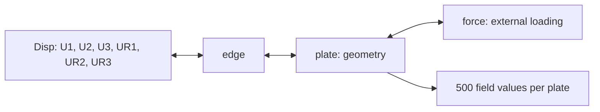

# Improved Heterogeneous Graph Representation for Stiffened Panels

A focused demonstration of the **improved heterogeneous graph representation** for stiffened panels with non-uniform boundary conditions and external loads, developed in *A hybrid global–local computational framework for ship hull structural analysis using homogenized model and graph neural network* by Yuecheng Cai and Jasmin Jelovica.

This repository includes a runnable notebook, **32 real Case 3 samples**, and a pretrained stress model. Case 3 is the most complex case: a three-cell box beam with double sides and hydrostatic loading. Each graph represents a local stiffened panel extracted from that structure. The presentation follows our [homogeneous GNN demonstration](https://github.com/YuechengCai/GNN-stiffened-panel).

## Graph representation

Each graph represents an entire panel using structural units rather than individual finite-element mesh vertices.

| Node type | Role | Input features per node |
|---|---|---:|
| `plate` | Plate geometry | 3 |
| `force` | External loading, represented separately | 10 |
| `edge` | Structural edge information | 10 |
| `Disp` | All six prescribed displacement/rotation DOFs concatenated | 360 = 6 × 60 |



The graph has **four node types and 20 directed relation types**. The `edge` node type describes a physical structural edge; it is distinct from a graph connection. The number of nodes varies with the panel. `Disp` combines the six DOFs for each relevant boundary, rather than combining every boundary into one global node. See [the data schema](data/README.md).

## Method origins

Our earlier paper, *Heterogeneous Graph Representation of Stiffened Panels with Non-Uniform Boundary Conditions and Loads* (Paper 2), introduced and compared six heterogeneous graph representations. The subsequent hybrid global–local framework (Paper 3, Section 2.3.1) refined that work by combining two strategies: representing structural edges and boundary DOFs as separate node types, and concatenating all six boundary DOFs within each boundary node. External loading is also represented independently. This repository demonstrates that improved four-node-type representation.

This release covers the local panel graph surrogate. The complete ESL global analysis and boundary-DOF recovery pipeline from Paper 3 is outside its scope.

## Quick start

```bash
git clone https://github.com/YuechengCai/HGNN-stiffened-panel.git
cd HGNN-stiffened-panel
python -m pip install -r requirements.txt
python demo.py inspect
python demo.py predict
jupyter lab demo.ipynb
```

Run the notebook cells in order. The data and weights are already included, so no external dataset download or local path edits are needed. The notebook shows graph construction, pretrained inference, reference/prediction/error contours, field comparisons, and an optional short training run.

CPU inference is supported. CUDA is selected automatically when available; pass `--device cpu` to force CPU. Install a PyTorch build suitable for your platform before the remaining dependencies if necessary.

## Train a model

```bash
# Short training/checkpoint/inference demonstration
python demo.py train --epochs 3 --output outputs/quick_train

# Train longer on the supplied 24 training graphs
python demo.py train --epochs 500 --batch-size 8 --layers 10 --hidden 64 --lr 0.0001 --output outputs/retrain

# Evaluate your saved checkpoint
python demo.py predict --checkpoint outputs/retrain/best_model.pt --output outputs/retrain_prediction

# The example data also includes stored displacement targets
python demo.py train --target U1 --epochs 3 --output outputs/U1_demo
```

The demo uses the **full-size research HGT**: ten HGT layers, 64 hidden channels, four attention heads, and a final HGT layer with 500 output channels. It has **4,887,056 trainable parameters**. Stored research input scaling and physical stress targets are preserved; no additional input standardization or target rescaling is applied.

The original checkpoint supplies weights from zero-based epoch 480 of the research training run. The released weights are further adapted on the validated Case 3 graph inputs. The saved history describes this additional fine-tuning phase, rather than claiming the original research training was repeated from scratch.

BatchNorm retains the original shared affine parameters, but stores running means and variances separately for `plate`, `force`, `Disp`, and `edge`. Its training forward map is verified to match the research implementation exactly. Type-specific inference moments are fitted on training data only and saved in the checkpoint; this prevents statistics from different node types being mixed at inference.

Additional fine-tuning uses AdamW, weight decay 0.0001, and an effective batch size of 64. It starts at learning rate 0.00003 with two microbatches of 32. Large variable-size graph batches caused GPU memory paging, so training resumes from the saved best checkpoint with four microbatches of 16 and a reset optimizer at learning rate 0.00001. Gradients are weighted by their actual number of field values. The restart and batch sizes are recorded explicitly in the configuration and history.

A validation-based scheduler halves the learning rate after eight epochs without improvement, down to 0.000001. The lowest-validation-MSE checkpoint is retained. This run completed **25 additional epochs** and selected the checkpoint labelled **additional epoch 23**. It was stopped after a convergence review: the best validation RMSE improved by less than 0.01 MPa over the last eight completed epochs. The planned maximum of 50 was not reached. Actual completed epochs, selected checkpoint, phase timings, restart, and initialization are recorded separately from the original research training.

## Data and pretrained model

- `data/case3_demo.zip`: 24 training, 4 validation, and 4 test graphs; approximately 7 MiB. Contains inspectable CSV files and a sample manifest, loaded directly from ZIP.
- `pretrained/case3_stress.pt`: weights trained locally on **4,800 original Case 3 training graphs**, selected using 200 separate validation graphs. Only 24 of those training graphs are released. No optimizer state or full research dataset is included.
- `pretrained/training_history.json`: the training/validation history, including learning rates and elapsed time.
- `pretrained/metrics.json`: results on the four bundled test examples.
- `pretrained/full_test_metrics.json`: results on all 999 test graphs, including the median and 90th percentile of per-graph RMSE.
- `pretrained/experiment_config.json`: exact experiment settings and split ranges.

The notebook and default CLI evaluate only the four bundled test examples; the full-test report evaluates 999 graphs. These are demo results, not paper benchmark metrics. A three-epoch run checks the workflow and should not be expected to converge. Retraining on the released 24-graph subset produces a different model from the bundled 4,800-graph checkpoint.

The full local recipe uses effective batch size 64 and seed 42. Training uses original graph indices `[0, 4800)`, validation uses `[5400, 5600)`, and testing uses `[4800, 5400)` plus `[5600, 5999)` (zero-based, half-open ranges). There are 5,999 graphs in the available cache. This preserves the existing Case 3 training/validation ranges and evaluates all remaining graphs. BatchNorm moments use training graphs only; checkpoint selection uses validation graphs only. These are graph-level splits; related panels can originate from the same box-beam geometry. The omitted training samples and original initialization are required to reproduce the supplied checkpoint.

On the full 999-graph test set (9,315,500 field values), the released network has stress **RMSE 2.05 MPa** and **MAE 0.90 MPa**. Median per-graph RMSE is 0.88 MPa. Median panel-peak relative error is 3.07%; its 90th percentile is 17.88%, so local peaks remain less accurate for some panels. The checkpoint is approximately **19.76 MB (18.84 MiB)**, storing weights and inference statistics without optimizer state.

Paper 3 uses 4,800 training panels for its full study. This demo uses that training count and the full research network scale, with the explicit split and inference-statistics correction above. It is not a reproduction of the complete global ESL framework or all paper experiments. The optional three-epoch notebook cell uses only the 24 released training graphs and is disabled by default. Example selection is evenly spaced within each pool and does not depend on model errors.

Stress fields have 500 values per plate, plotted as a 10 × 50 grid using the original MATLAB column-major ordering. Displacement targets retain their original stored scaling; this demo does not claim to convert those values to physical displacement units.

The exporter corrected reversed source/destination rows in the two legacy `Disp ↔ edge` relations and verified all node indices. Node features and target fields were preserved exactly. The data documentation records this correction explicitly.

## Files

| File | Purpose |
|---|---|
| [demo.ipynb](demo.ipynb) | Main walkthrough with executed example outputs |
| [dataset.py](dataset.py) | CSV loading and improved heterogeneous graph construction |
| [model.py](model.py) | Full research HGT and saved node-type running statistics |
| [demo.py](demo.py) | Command-line training, inference, plots, and metrics |
| [tests/test_demo.py](tests/test_demo.py) | Graph, split, checkpoint, and inference checks |
| [validation.json](validation.json) | Recorded local environment and verification results |

Generated checkpoints, metrics, figures, and predictions go into `outputs/`, which is ignored by Git. Prediction archives record graph IDs and plate counts so field arrays can be mapped back to individual panels.

## Environment and verification

Validated locally with Python 3.11.13, PyTorch 2.7.1+cu126, PyTorch Geometric 2.6.1, and an NVIDIA RTX 3090 in the `dxtorch` environment. CPU pretrained inference was also checked. Exact package versions and verification results are recorded in `validation.json`.

```bash
python -m unittest discover -s tests -v
```

## Scope

Only the improved graph representation and a small Case 3 subset are released. Other cases, ablation studies, complete training datasets, Optuna databases, and research result folders are outside this demonstration. The bundled weights demonstrate the released training workflow and do not reproduce the full paper's reported accuracy.
