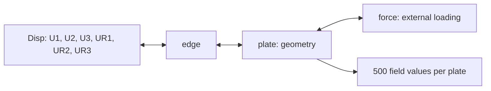

# Heterogeneous Graph Neural Network for Stiffened Panels

A focused demonstration of the **V3 heterogeneous graph representation** for stiffened panels with non-uniform boundary conditions and external loads, associated with *Heterogeneous Graph Representation of Stiffened Panels with Non-Uniform Boundary Conditions and Loads* by Yuecheng Cai and Jasmin Jelovica.

This repository includes a runnable notebook, **32 real Case 1 samples**, and a small pretrained stress model. It follows the notebook-based presentation of our [homogeneous GNN demonstration](https://github.com/YuechengCai/GNN-stiffened-panel).

## Graph representation

Each graph represents an entire panel using structural units rather than individual finite-element mesh vertices.

| Node type | Role | Input features per node |
|---|---|---:|
| `plate` | Plate geometry | 3 |
| `force` | External loading, represented separately | 9 |
| `edge` | Structural edge information | 10 |
| `Disp` | All six prescribed displacement/rotation DOFs concatenated | 360 = 6 × 60 |



The graph has **four node types and 20 directed relation types**. The `edge` node type describes a physical structural edge; it is distinct from a graph connection. The number of nodes varies with the panel. `Disp` combines the six DOFs for each relevant boundary, rather than combining every boundary into one global node. See [the data schema](data/README.md).

## Quick start

```bash
git clone https://github.com/YuechengCai/HGNN-stiffened-panel.git
cd HGNN-stiffened-panel
python -m pip install -r requirements.txt
python demo.py inspect
python demo.py predict
jupyter lab demo.ipynb
```

Run the notebook cells in order. The data and weights are already included, so no external dataset download or local path edits are needed. The notebook shows graph construction, pretrained inference, reference/prediction/error contours, field comparisons, and an optional short training run.

CPU inference is supported. CUDA is selected automatically when available; pass `--device cpu` to force CPU. Install a PyTorch build suitable for your platform before the remaining dependencies if necessary.

## Train a model

```bash
# Short training/checkpoint/inference demonstration
python demo.py train --epochs 3 --output outputs/quick_train

# Train longer on the supplied 24 training graphs
python demo.py train --epochs 200 --batch-size 8 --layers 4 --hidden 64 --lr 0.001 --output outputs/retrain

# Evaluate your saved checkpoint
python demo.py predict --checkpoint outputs/retrain/best_model.pt --output outputs/retrain_prediction

# The example data also includes stored displacement targets
python demo.py train --target U1 --epochs 3 --output outputs/U1_demo
```

The demo uses the residual **`FHGT_YC_V2` network from the research source code**, with four HGT layers, 64 hidden channels, four attention heads, dropout 0.1, and a linear head on plate nodes. **V3 refers to the graph representation; V2 refers to the network implementation.** Input standardization and target scaling are fitted on the training split only and saved in the checkpoint. Outputs are restored to their stored target units before reporting errors. The original shared-BatchNorm `FHGT_YC` checkpoint is not distributed here.

AdamW uses weight decay 0.0001 and a constant learning rate. The checkpoint with the lowest validation MSE is retained. This compact training recipe differs from the full experiments and hyperparameter searches in the paper.

## Data and pretrained model

- `data/case1_demo.zip`: 24 training, 4 validation, and 4 test graphs; approximately 9.3 MiB. Contains inspectable CSV files and a sample manifest, loaded directly from ZIP.
- `pretrained/case1_stress.pt`: weights trained locally on **400 original training graphs** (indices 0–399), selected by the four bundled validation graphs. Only 24 of those training graphs are released. No optimizer state or full research dataset is included.
- `pretrained/training_history.json`: the 200-epoch training/validation history.
- `pretrained/metrics.json`: results on the four held-out demo graphs.

The checkpoint's test results are recorded in `pretrained/metrics.json` over 44,000 field values. These are demo results, not paper benchmark metrics. A three-epoch run checks the workflow and should not be expected to converge. Retraining on the released 24-graph subset will produce a different model from the bundled 400-graph checkpoint.

The pretrained recipe uses the same network, AdamW learning rate 0.001, batch size 64, seed 42, and 200 epochs on the original 400-graph training range; input and target normalization use only those training graphs. Validation uses original graph IDs 5100, 5166, 5232, and 5299. Checkpoint selection never uses the four test graphs. The omitted training samples are required to reproduce that checkpoint from scratch.

Stress fields have 500 values per plate, plotted as a 10 × 50 grid using the original MATLAB column-major ordering. Displacement targets retain their original stored scaling; this demo does not claim to convert those values to physical displacement units.

The exporter corrected reversed source/destination rows in the two legacy `Disp ↔ edge` relations and verified all node indices. Node features and target fields were preserved exactly. The data documentation records this correction explicitly.

## Files

| File | Purpose |
|---|---|
| [demo.ipynb](demo.ipynb) | Main walkthrough with executed example outputs |
| [dataset.py](dataset.py) | CSV loading and V3 graph construction |
| [model.py](model.py) | Residual HGT and saved normalization statistics |
| [demo.py](demo.py) | Command-line training, inference, plots, and metrics |
| [tests/test_demo.py](tests/test_demo.py) | Graph, split, checkpoint, and inference checks |
| [validation.json](validation.json) | Recorded local environment and verification results |

Generated checkpoints, metrics, figures, and predictions go into `outputs/`, which is ignored by Git. Prediction archives record graph IDs and plate counts so field arrays can be mapped back to individual panels.

## Environment and verification

Validated locally with Python 3.11.13, PyTorch 2.7.1+cu126, PyTorch Geometric 2.6.1, and an NVIDIA RTX 3090 in the `dxtorch` environment. CPU pretrained inference was also checked. Exact package versions and verification results are recorded in `validation.json`.

```bash
python -m unittest discover -s tests -v
```

## Scope

Only one graph representation and a small Case 1 subset are released. Other cases, ablation studies, complete training datasets, Optuna databases, and research result folders are outside this demonstration. The bundled weights demonstrate the released training workflow and do not reproduce the full paper's reported accuracy.
